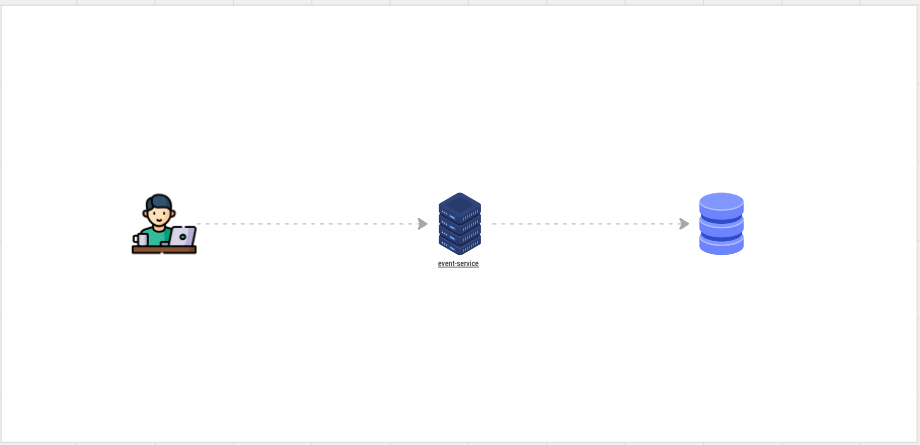
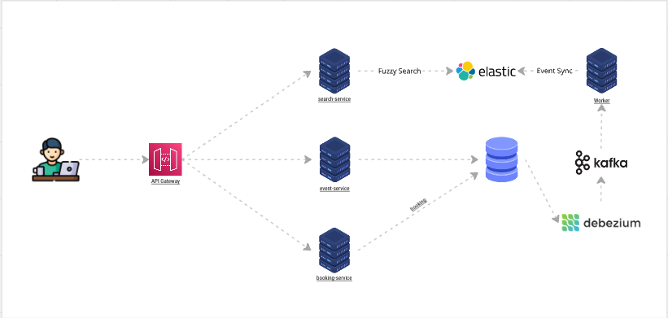
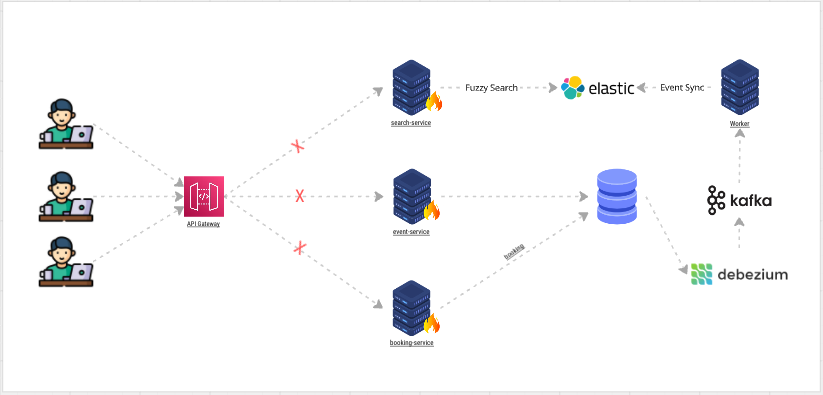
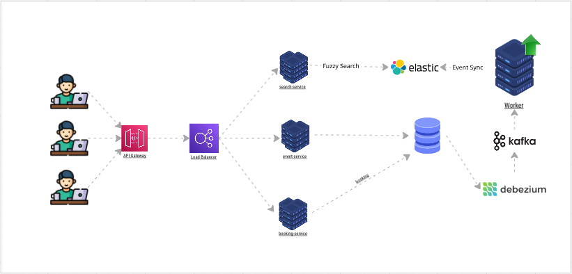
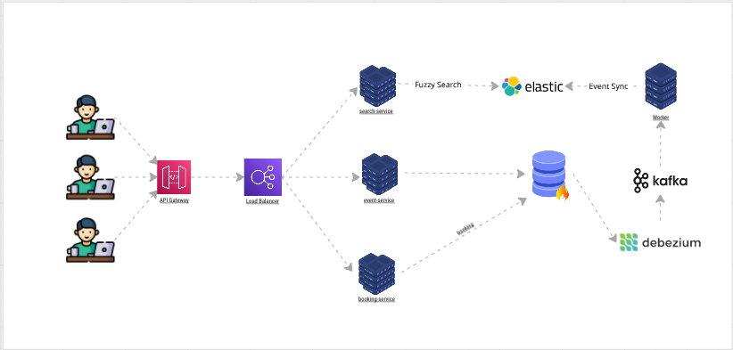
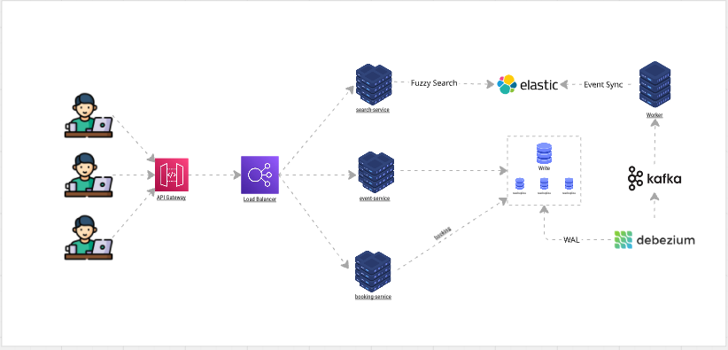
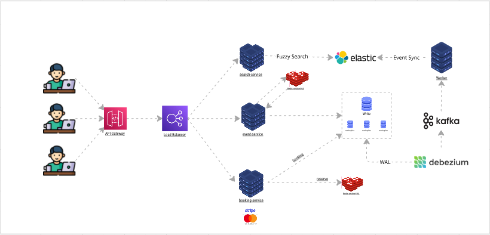

# Plataforma de venda de ingressos — Arquitetura

Documentação de arquitetura de uma plataforma de venda de ingressos para eventos, cobrindo requisitos, modelo de dados, componentes, escalabilidade e as decisões técnicas tomadas ao longo do caminho.

Este repositório não contém código de aplicação. O objetivo é registrar **como** o sistema foi pensado e **por que** cada decisão foi tomada.

## Problema

Vender ingressos para eventos grandes exige lidar com:

- picos de milhões de usuários simultâneos em aberturas de venda;
- leitura muito superior à escrita (proporção estimada de 100:1);
- busca tolerante a erros de digitação;
- garantia de que dois usuários não comprem o mesmo assento.

## Índice

| Documento | Conteúdo |
|---|---|
| [Requisitos](docs/01-requisitos.md) | Requisitos funcionais e não funcionais |
| [Estimativas](docs/02-estimativas.md) | Premissas de carga e latência |
| [Modelo de domínio](docs/03-modelo-de-dominio.md) | Entidades, atributos e estados do ingresso |
| [Arquitetura](docs/04-arquitetura.md) | Componentes, responsabilidades e fluxos |
| [Escalabilidade](docs/05-escalabilidade.md) | Problemas identificados e como foram tratados |
| [Fluxo de reserva](docs/06-fluxo-de-reserva.md) | Reserva e expiração |
| [Decisões (ADRs)](docs/adr/) | Registro das decisões técnicas e seus trade-offs |
| [Diagramas](diagrams/) | Diagramas exportados e fontes versionadas |

## Diagramas e descrições

Cada diagrama foi desenhado no Miro durante o levantamento. Os prints estão em [diagrams/](diagrams/) e as descrições ao lado de cada um são o texto dos cards do board.

🔗 **Board interativo:** [miro.com/app/board/uXjVEZN5tNo=](https://miro.com/app/board/uXjVEZN5tNo=/?share_link_id=399692673299)

### 1. Requisitos

**Funcionais:** visualização de eventos, pesquisa de eventos e compra de ingressos.

**Não funcionais:** pico de 10 milhões de usuários simultâneos, pesquisa tolerante a erros de digitação, pesquisa em menos de 500 ms, leitura na proporção 100:1, consistência para impedir venda dupla de assento e alta disponibilidade.

### 2. Modelo de entidades

Entidades: `User`, `Event`, `Venue` (com `SeatMap`), `Ticket` (status `available`, `unavailable` ou `booked`) e `Booking`. Detalhes em [modelo de domínio](docs/03-modelo-de-dominio.md).

### 3. Arquitetura inicial

Entrada por API Gateway, com `event-service`, `search-service`, `booking-service` e `Worker`, atrás de um Load Balancer. Detalhes em [arquitetura](docs/04-arquitetura.md).

### 4. Amadurecendo a arquitetura

> Separar as aplicações para que cada uma seja responsável por uma ação específica. Isso faz com que a competição por recursos entre as funções deixe de existir.
>
> **event-service** é responsável por receber a criação de eventos e retornar os seus detalhes.
>
> **search-service** é responsável por realizar buscas inteligentes com **Fuzzy Search**, utilizando o **Elasticsearch** como motor de busca.
>
> **booking-service** é responsável por processar as reservas do usuário.
>
> **OBS:** foi adicionado um mecanismo de CDC (**Change Data Capture**) com o **Debezium**, que captura as criações e alterações de registros no banco de dados e publica essas mudanças no **Kafka**. Um worker consome essas mensagens e as envia ao **Elasticsearch**, mantendo o sistema de busca atualizado de forma automática e segura.

Ver [ADR 0001](docs/adr/0001-separar-servicos.md) e [ADR 0002](docs/adr/0002-cdc-para-atualizar-busca.md).

### 5. Single point of failure

Problema: se um serviço cair, a aplicação para. Ver [escalabilidade](docs/05-escalabilidade.md#1-ponto-único-de-falha).

### 6. Escalabilidade dos serviços

> Escalar horizontalmente resolve o problema de ponto único de falha.
>
> Se algum serviço cair, outra instância sobe imediatamente, fazendo com que a aplicação tenha tolerância a falhas.
>
> Com isso, o load balancer passa a direcionar as requisições para as instâncias que continuam ativas.

### 7. Sobrecarga no banco de dados

Problema: o banco recebe consultas repetidas por dados que raramente mudam. Ver [escalabilidade](docs/05-escalabilidade.md#2-sobrecarga-no-banco-de-dados).

### 8. Escalabilidade do banco de dados

O banco de escrita fica no centro, com réplicas de leitura. O Debezium lê o WAL do banco e alimenta o Kafka, de onde o worker atualiza a busca. Ver [escalabilidade](docs/05-escalabilidade.md#3-escalabilidade-do-banco-de-dados).

### 9. Melhora de performance para altas volumetrias

> Para melhorarmos a performance e a saúde da aplicação, seguindo a regra:
>
> "Pesquisa por eventos em menos de 500 ms"
>
> Em vez de consultar o banco o tempo todo por dados que raramente mudam (como os detalhes do evento), podemos adicionar uma camada de cache. Ela protege o banco da maioria das consultas e traz grande velocidade, pois os dados ficam na camada mais rápida: a **memória**.
>
> Utilizaremos o **Redis Sentinel HA** para gerenciar esse cache e também o lock das reservas temporárias, com prazo de expiração definido.
>
> O prazo de expiração libera o assento automaticamente caso o usuário não conclua a compra, evitando que assentos fiquem presos.

Ver [ADR 0003](docs/adr/0003-redis-para-cache-e-locks.md), que registra o risco de perda de lock em failover.

## Decisões principais

| # | Decisão |
|---|---|
| [0001](docs/adr/0001-separar-servicos.md) | Separar o sistema em serviços por responsabilidade |
| [0002](docs/adr/0002-cdc-para-atualizar-busca.md) | Usar CDC com Debezium e Kafka para alimentar a busca |
| [0003](docs/adr/0003-redis-para-cache-e-locks.md) | Usar Redis para cache e locks temporários de reserva |
| [0004](docs/adr/0004-elasticsearch-para-busca.md) | Usar Elasticsearch como motor de busca |
